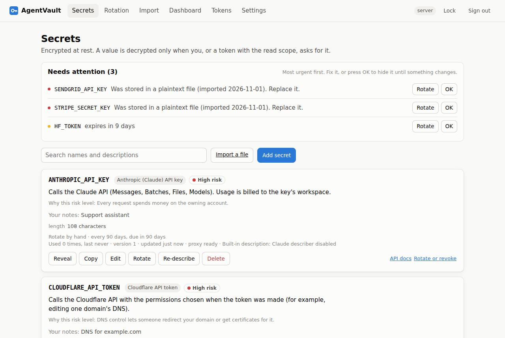
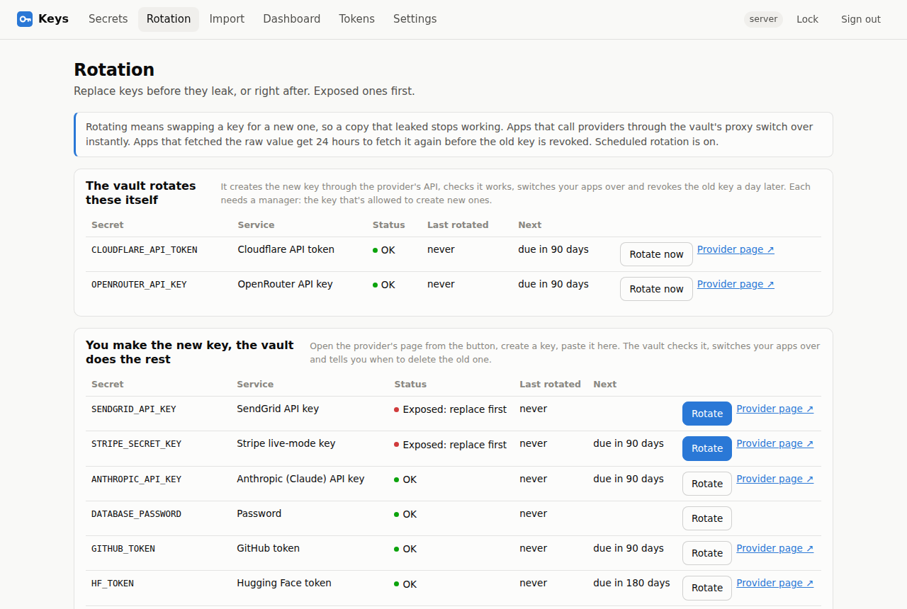
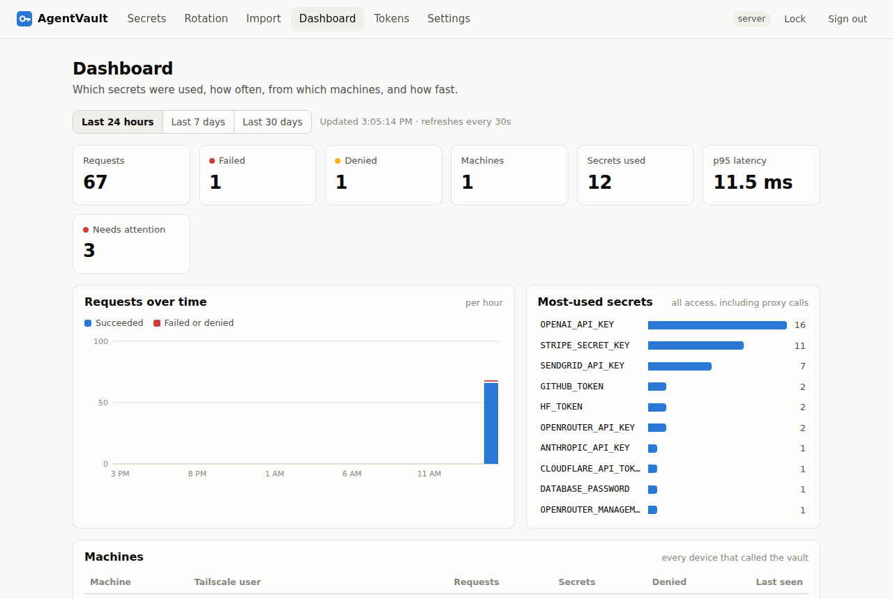
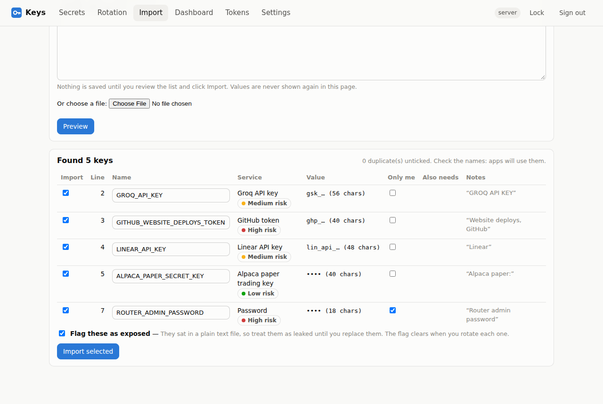
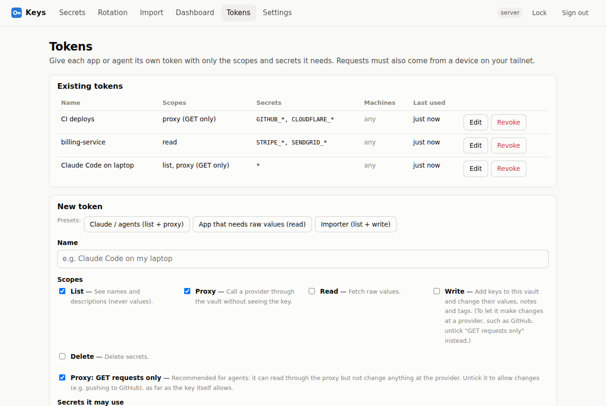

# AgentVault

A secrets vault for your Tailscale network, in one Rust binary. Store your API keys once, then let your apps and AI agents use them over HTTPS, without copying `.env` files around and, through the proxy, without ever handing over the key.

> **Status: early (v0.1).** It works and is well tested, but it has not had an independent security audit, and the automatic rotators have so far only been tested against simulated providers (see [Limitations](#limitations)). Report security problems privately: see [SECURITY.md](SECURITY.md).



## What it does

- **Web interface** for adding, editing, revealing, importing and rotating keys.
- **Proxy:** `/v1/proxy/NAME/...` calls the provider with the key attached on the server, so the caller never sees the key.
- **For AI agents:** an MCP endpoint and a Claude skill. Claude can find and use your keys, with no way to read them.
- **REST API** with everything the web interface does.
- **Knows your keys.** When you add a key, the vault:
  - recognises the provider from the key's format (48 providers);
  - asks the provider what the key can do;
  - writes a plain-English description and risk rating.
- **Import:** paste a `.env` file or free-form notes. The vault:
  - proposes names;
  - links parts that belong together (key ID + secret, login + password);
  - skips duplicates;
  - flags everything as exposed until replaced.
- **Rotation:**
  - for OpenRouter, Cloudflare, Tailscale, Azure and Google, the vault makes the new key itself;
  - for everything else, a guided flow with a link to the right page;
  - old keys are revoked after a grace period, and any rotation can be undone until then.
- **Scoped tokens:** each app or agent gets its own token. It can be limited to:
  - which keys it can use;
  - which machines it works from;
  - read-only requests through the proxy.
- **Owner-only secrets:** passwords and wallet keys can be hidden from every token.
- **Needs attention:** exposed, expired, rejected, overdue or incomplete keys, most urgent first.
- **Dashboard:** usage per key and per machine, with latency.
- **Tamper-evident audit log.**

| | |
|---|---|
|  |  |
|  |  |

## Quick start

1. In the [Tailscale admin console](https://login.tailscale.com/admin/dns), turn on **MagicDNS** and **HTTPS Certificates**.
2. On the Linux machine that will hold the vault, download and install it. Use `aarch64` instead of `x86_64` on ARM:
   ```sh
   curl -LO https://github.com/michaelbaker-dev/agentvault/releases/latest/download/agentvault-x86_64-linux.tar.gz
   tar -xzf agentvault-x86_64-linux.tar.gz && cd agentvault-x86_64-linux
   sudo ./install.sh
   ```
3. Open the address it prints (`https://<machine>.<tailnet>.ts.net`) on one of your devices and choose a passphrase. Then answer **Y** in the terminal to have the vault unlock itself after a reboot.
4. Add your keys: **Add secret**, or **Import** to paste a whole file.
5. Make a token on the **Tokens** page for each app or agent, and use it as shown in [Use it](#use-it).

## Requirements

- **The vault machine:**
  - Linux with systemd (for example Debian 12+, Ubuntu 22.04+ or Fedora), on x86_64 or ARM64;
  - `python3` and `curl`, used by the installer;
  - **Tailscale**, signed in, with MagicDNS and HTTPS Certificates turned on for your tailnet;
  - port 443 free on its Tailscale address (another port works too, see [Change the address or port](#change-the-address-or-port)).
- **Your devices:** any device on the same tailnet with a modern browser. The web interface only lets in the Tailscale login that installed the vault.
- **To build from source:** Rust 1.89 or newer and a C compiler (`build-essential` or equivalent).

## Install

**From a release** (no Rust needed): see the [Quick start](#quick-start).

**From source:**

```sh
git clone https://github.com/michaelbaker-dev/agentvault && cd agentvault
cargo build --release
sudo deploy/install.sh
```

The installer checks the requirements first and tells you what to fix. It then:
- creates a `agentvault` system user;
- installs the program and writes `/etc/agentvault/config.toml`, listening on the machine's Tailscale address, port 443;
- gets a real HTTPS certificate from Tailscale and renews it weekly;
- starts the hardened service and offers to turn on [automatic unlock](#unlocking-after-a-reboot).

**Tagged machines.** If the machine is tagged in Tailscale, it doesn't belong to a person, so tell the installer whose vault it is: `sudo AGENTVAULT_OWNER=you@example.com ./install.sh`.

**The passphrase is the only way to decrypt the vault, and it can't be reset. Keep a copy offline.**

### Upgrade

Download the new release (or `git pull && cargo build --release`) and run the installer again. Your keys, settings and automatic unlock are kept.

### Uninstall

```sh
sudo ./uninstall.sh            # removes the service and program; keeps your vault and settings
sudo ./uninstall.sh --purge    # also securely deletes the vault and settings (asks you to confirm)
```

From a source checkout, it's `deploy/uninstall.sh`.

### Unlocking after a reboot

The vault's encryption key lives only in memory, so after a restart it starts **locked**: apps get `503` until it's unlocked. You can sign in after each restart, or have it unlock itself:

```sh
sudo /usr/local/lib/agentvault/auto-unlock        # asks for your passphrase, restarts the vault, checks it unlocked
sudo /usr/local/lib/agentvault/auto-unlock off    # back to signing in after each restart
```

The installer offers to run this for you. The passphrase is stored as an encrypted systemd credential (`/etc/agentvault/passphrase.cred`). If the passphrase you type doesn't unlock the vault, the script puts everything back as it was. **Settings** shows whether automatic unlock is on. If you change your passphrase, the Secrets page warns you until you run the script again.

On a machine with a TPM security chip, systemd seals the credential to that chip. Without one, it's protected by a host key that only root can read. Either way, anyone with root on the vault machine can unlock the vault. That's the price of starting unattended.

## Import your keys

Open **Import** and paste a file or choose one. Click **Preview**, check the names and fill in anything marked "Also needs", then click **Import selected**. To see what would happen without running a server:

```sh
agentvault import-preview keys.txt     # every value masked; nothing stored or sent
```

Afterwards, delete the file everywhere it exists (`shred -u keys.txt`). Then replace the exposed keys from the **Rotation** page, or press **OK** on the ones you accept the risk for.

## Rotation

Rotating means swapping a key for a new one, so a copy that leaked stops working. Apps that call providers through the proxy switch over instantly. Apps that fetched the raw value have `grace_hours` (24 by default) to fetch it again before the old key is revoked. Every rotation can be undone until then.

| Provider | How | What the vault needs |
|---|---|---|
| OpenRouter keys | Automatic | An OpenRouter **management key** ([create one](https://openrouter.ai/settings/management-keys)) stored in the vault and set as the key's manager. The vault creates the new key with the same spending limit and deletes the old one. |
| Cloudflare tokens | Automatic (roll) | A token allowed to roll tokens. Create one from the "Create additional tokens" template at [API Tokens](https://dash.cloudflare.com/profile/api-tokens), store it and set it as manager. A token that has that permission itself can roll without one. The old value stops working at once. |
| Tailscale auth keys | Automatic | A Tailscale **OAuth client** with the `auth_keys` scope and a tag ([trust credentials](https://console.tailscale.com/admin/settings/trust-credentials)), stored with its `client_id` field and set as manager. The new key copies the old one's tags. |
| Microsoft Entra (Azure) client secrets | Automatic | The secret's `tenant_id` and `client_id` fields. The app must also be allowed to manage itself: grant it `Application.ReadWrite.OwnedBy` and make its service principal an owner of the application (a one-time admin step). |
| Google API keys | Automatic | A **service account** JSON key with the API Keys Admin role (`roles/serviceusage.apiKeysAdmin`) on the project, stored and set as manager. The new key keeps the old one's restrictions. |
| Anthropic keys | Guided, old key disabled automatically | Anthropic has no API to create keys. Create one at [platform.claude.com/settings/keys](https://platform.claude.com/settings/keys) and paste it. With an Anthropic **Admin key** as manager, the vault disables the old key after the grace period. |
| GitHub | Renews itself | Use a **GitHub App** instead of a personal token: store its private key with `app_id` and `installation_id`. Apps get installation tokens that expire after an hour. |
| Slack | Renews itself | Turn on token rotation for the Slack app (this can't be turned off), then store the refresh token with `client_id` and a `client_secret` part. Bot tokens are refreshed every 12 hours. |
| Tailscale API | Renews itself | Store an OAuth client instead of an API key. The proxy uses hour-long tokens. |
| Everything else | Guided | The **Rotate** button shows the steps and opens the provider's key page. Paste the new key; the vault checks it with the provider, switches over and reminds you to delete the old one. |
| Wallet keys | Can't be rotated | Move the funds to a new wallet. |

When a key is due by its schedule, the scheduler rotates it while the vault is unlocked and `scheduled = true`.

## Use it

Create a token on the **Tokens** page and pick the narrowest preset that works. You can change a token's permissions later with **Edit**, without replacing it. Keep the token in a file or a secrets manager, not on a command line:

```sh
read -rs AGENTVAULT_TOKEN && export AGENTVAULT_TOKEN      # paste the token; it isn't shown or saved in your history

# an app that needs the raw value
curl -s -H "Authorization: Bearer $AGENTVAULT_TOKEN" https://HOST/v1/secrets/DB_PASSWORD/value

# call a provider without ever holding its key
curl -s -H "Authorization: Bearer $AGENTVAULT_TOKEN" https://HOST/v1/proxy/OPENAI_API_KEY/v1/models
```

### From Claude: MCP, a skill, or both

Make a token with the preset **Claude / agents** (list + proxy, GET-only), tied to the machine Claude runs on. Then, in your own terminal:

```sh
ln -s "$PWD/skill/agentvault" ~/.claude/skills/agentvault   # the skill (once per machine)
~/.claude/skills/agentvault/scripts/agentvault-cli setup          # asks for the token without showing it, checks it, saves it, connects MCP
```

Restart Claude Code afterwards. `setup` connects both routes:

| | Claude sees the token? | Works in |
|---|---|---|
| **MCP** | No. It stays in Claude Code's settings, and Claude only gets list, describe and proxy tools. | Claude Code, Claude Desktop, any MCP client |
| **Skill + helper** | It could read `~/.config/agentvault/token`, so keep that token to list + proxy on one machine, where it can't reveal any key. | Anything with a shell |

The skill (`skill/agentvault/`) teaches Claude good habits whichever route is connected:
- use the vault instead of asking you for keys;
- prefer the proxy;
- keep keys out of code, `.env` files and commits;
- make apps fetch keys at runtime.

It also brings a helper, `skill/agentvault/scripts/agentvault-cli` (Python, standard library only), which works on its own too:

```sh
agentvault-cli setup                                 # address + token, checked; connects MCP (--no-mcp to skip)
agentvault-cli check                                 # reachable, unlocked, token works?
agentvault-cli list [word]                           # keys this token may use; no values
agentvault-cli describe GITHUB_TOKEN                 # what it's for, risk, proxy address
agentvault-cli call GITHUB_TOKEN /user               # call the provider through the vault
agentvault-cli run OPENAI_API_KEY -- python app.py   # program gets the key; output has it blanked (needs read scope)
```

### Descriptions written by Claude

Add your Anthropic API key to the vault as `ANTHROPIC_API_KEY`. From then on, Claude writes each new key's description (`claude-opus-5-5` at low effort, billed to your Anthropic account; set `model` in `[describe]` to use another model). Without it, the vault uses built-in descriptions. Claude receives only:
- the name and your notes;
- the detected provider;
- what the provider reported about the key.

It never receives the value.

### REST API

| Method | Path | Scope |
|---|---|---|
| GET | `/v1/secrets` | list |
| POST | `/v1/secrets` `{name, value, notes?, tags?, verify?}` | write |
| GET | `/v1/secrets/NAME` | list |
| PATCH | `/v1/secrets/NAME` `{name?, value?, notes?, tags?}` (`proxy` is owner-only) | write |
| DELETE | `/v1/secrets/NAME` | delete |
| GET | `/v1/secrets/NAME/value` | read |
| POST | `/v1/secrets/NAME/describe` | write |
| ANY | `/v1/proxy/NAME/PATH` | proxy |
| POST | `/mcp` | list / proxy |
| GET | `/v1/dashboard?range=24h\|7d\|30d`, `/v1/events`, `/v1/audit/verify`, `/v1/tokens` | owner session |
| POST | `/v1/tokens` `{name, scopes, secrets?, nodes?, proxy_get_only?}` | owner session |
| PATCH | `/v1/tokens/ID` (same fields; takes effect on the token's next request) | owner session |
| DELETE | `/v1/tokens/ID` (revoke) | owner session |
| POST | `/v1/secrets/NAME/rotate` `{}` (automatic) or `{value, fields?, extras?, skip_check?}` (by hand) | owner session |
| GET | `/v1/rotations`, `/v1/attention`, `/v1/providers` | owner session |
| POST | `/v1/attention/dismiss` `{secret}` (OK: hide its current items until something changes), `/v1/attention/restore` `{secret}` | owner session |
| POST | `/v1/rotations/ID/rollback`, `/v1/rotations/ID/done` | owner session |
| POST | `/v1/import/preview` `{text}`, `/v1/import/commit` `{import_id, items}` | owner session |

Secrets made of several parts carry `extras: [{name, value}]` (encrypted) and `fields: {name: value}` (plaintext, owner-only to change). The proxy can send them with `basic:<field>` or `headers:Name={part};Other={value}`.

## Running it

### Back up and restore

Everything is in one database file, `/var/lib/agentvault/data/agentvault.db`. The values inside it are encrypted, so a copy is safe to store anywhere, but it's useless without your passphrase.

```sh
# back up (the vault restarts; with automatic unlock it unlocks itself)
sudo systemctl stop agentvault
sudo cp /var/lib/agentvault/data/agentvault.db ~/agentvault-backup-$(date +%F).db
sudo systemctl start agentvault

# restore
sudo systemctl stop agentvault
sudo install -o agentvault -g agentvault -m 0600 ~/agentvault-backup-YYYY-MM-DD.db /var/lib/agentvault/data/agentvault.db
sudo rm -f /var/lib/agentvault/data/agentvault.db-wal /var/lib/agentvault/data/agentvault.db-shm
sudo systemctl start agentvault
```

A backup opens with the passphrase that was in use **when it was taken**. If automatic unlock has a newer passphrase, sign in with the old one, then run `sudo /usr/local/lib/agentvault/auto-unlock` again.

### Change the address or port

Edit `/etc/agentvault/config.toml` (every option is documented in [config.example.toml](config.example.toml)), then run `sudo systemctl restart agentvault`. For example, `listen = "100.x.y.z:8443"` moves the vault to `https://<machine>.<tailnet>.ts.net:8443`.

### Troubleshooting

| Problem | What to check |
|---|---|
| Can't reach the vault | Is your device on the same tailnet? On the vault machine: `systemctl status agentvault` and `journalctl -u agentvault -n 50`. |
| Apps get `503` / "vault is locked" | It restarted and isn't unlocked. Sign in, or turn on [automatic unlock](#unlocking-after-a-reboot). |
| Certificate warnings in the browser | Run `sudo systemctl start agentvault-cert` and check HTTPS Certificates is on in the Tailscale admin console. |
| "Only the owner's devices can sign in" | Only devices logged in to Tailscale as the owner (`owner` in the config) can sign in. Others use tokens. |
| A token gets `403` | It lacks a scope, the key isn't in its list, or it's used from another machine. Fix it with **Edit** on the Tokens page. |
| Automatic unlock stopped working | You changed your passphrase. Run `sudo /usr/local/lib/agentvault/auto-unlock` again. |
| Forgot the passphrase | It can't be recovered or reset. Restore won't help either; start over with `uninstall.sh --purge`. |

## Security model

| Layer | What it does |
|---|---|
| Network | Binds only to the Tailscale IP. Rejects foreign `Host` headers (DNS rebinding) and cross-origin browser requests. |
| Device identity | Every request is attributed to a tailnet device and user via tailscaled, which WireGuard authenticates and which can't be spoofed. |
| Credential | Every request also needs a scoped token or the owner's web session. Device identity alone isn't enough, because an AI agent on your laptop shares the laptop's identity. |
| Tokens | Scopes (`list`, `read`, `write`, `delete`, `proxy`), secret-name patterns (`OPENAI_*`), optional machine pinning. Only the SHA-256 is stored, and tokens are revocable instantly. |
| Web session | Owner's devices only. The passphrase is required. The cookie is `HttpOnly; Secure; SameSite=Strict`, bound to the device's stable Tailscale node ID, and every call also needs a CSRF header. Sessions expire after 15 min idle or 12 h total. |
| Step-up | Revealing or copying a value, creating or editing a token, deleting, and changing a proxy target all need the passphrase entered in the last 5 minutes. A cookie stolen by an agent running as you can list secrets, but can't take them. |
| Encryption | Passphrase → Argon2id (64 MiB) → key-encryption key → root key → a fresh XChaCha20-Poly1305 data key per value version. Each ciphertext is bound to its secret id and version. The root key lives only in memory. **Lock** wipes it. |
| Proxy | Only the owner can change where a key is sent. Paths can't escape the provider's base URL. Only GET/POST/PUT/PATCH/DELETE are forwarded (TRACE would echo the key). The key is redacted from response bodies and headers, whether it comes back raw, base64-encoded or URL-encoded. Tokens can be limited to GET, so an agent can read through a key but can't mint new keys or change settings at the provider. Redirects aren't followed. |
| Process | Not dumpable (no core dumps, and same-user processes can't read its memory). Runs as its own system user under a strict systemd sandbox. |
| Brute force | 5 passphrase attempts per device per 15 minutes, counted before the check runs, so parallel guesses don't help. Argon2 attempts are capped at 2 concurrent. |
| Owner-only | Secrets marked "only me" (passwords and wallet keys start that way) don't exist as far as tokens are concerned: not listed, not readable, not usable through the proxy or MCP, and not named in duplicate warnings. |
| Owner settings | Only the owner can change who may see a secret, its linked plaintext fields, its provider, its manager, its rotation schedule or its proxy target. Exposing an owner-only secret, changing a manager or proxy, importing, rotating and undoing a rotation all need a fresh passphrase. |
| Rotation | A key set as another's manager becomes owner-only, and rotation refuses a manager that isn't owner-only or isn't the expected kind. Tokens can't change the value of a key that rotates, renews itself or manages another, so they can't steer which key the vault creates or revokes. A rotation stops before creating anything if the old key isn't in the manager's account. Managing credentials go only to their provider's fixed API address; IDs from provider replies are checked before they go into a URL; provider error text is redacted before it's logged or shown. Revocation and undo re-check the rotation under a per-key lock and never touch a key that changed since. A rotation that fails leaves the old key in place (a Cloudflare roll, which replaces the value at once, keeps the new value). |
| Import | Pasted text is parsed in memory. The preview shows only a public prefix and the length of each value; the values stay on the server for 30 minutes for the one device that pasted them, and are used up by the commit. |
| Duplicates | Detected with a fingerprint keyed by the vault's root key, so the database can't be used to test password guesses. |

Not covered:
- **Root access.** Someone with root on the vault machine while it's unlocked, or at any time if automatic unlock is on.
- **Misuse within a token's scopes.** A `proxy` token that isn't GET-only can do anything the key can do at the provider. It just can't take the key with it.
- **Names of owner-only secrets.** A token trying to create a secret under a name that an owner-only secret already uses gets "already exists".
- **Clearing the audit log.** It is hash-chained but not keyed, so someone who can write the database file can rewrite it end to end, or drop the newest rows, without detection. To keep a record off the machine, periodically export the head hash shown on the Settings page.

## Limitations

- **One owner per vault.** Only one Tailscale login can sign in to the web interface. Other people and programs use tokens.
- **The vault machine must run Linux with systemd.** Your other devices can be anything on the tailnet.
- **Tailscale only.** It relies on tailscaled for device identity and certificates. Headscale and other control servers are untested.
- **The automatic rotators are tested only against simulated providers.** That covers OpenRouter, Cloudflare, Tailscale, Azure and Google, and the renewal for GitHub Apps, Tailscale OAuth and Slack. The checks that ask a provider what a key can do have been run against many of the real services. Try a rotation on a key you can afford to lose first, and please report what you find.
- **No independent security audit yet.**

## Development

```sh
cargo test                                  # 78 tests: crypto, auth, tokens, CSRF, sealing, MCP, audit chain, import, every rotator against a fake provider
cargo fmt --check && cargo clippy --all-targets -- -D warnings
cargo deny check                            # advisories, licenses, sources
gitleaks dir .                              # no secrets in the tree
agentvault audit-verify -c /etc/agentvault/config.toml  # on the vault machine: is the hash chain intact?
```

CI runs all of these on every push. Pushing a tag such as `v0.1.0` builds the release downloads. See [CONTRIBUTING.md](CONTRIBUTING.md) to get involved and [CHANGELOG.md](CHANGELOG.md) for what changed.

## License

[MIT](LICENSE). Contributions are accepted under the same license.
